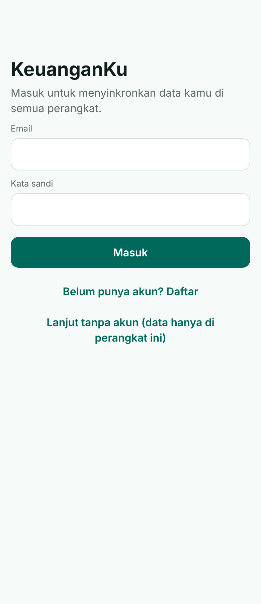
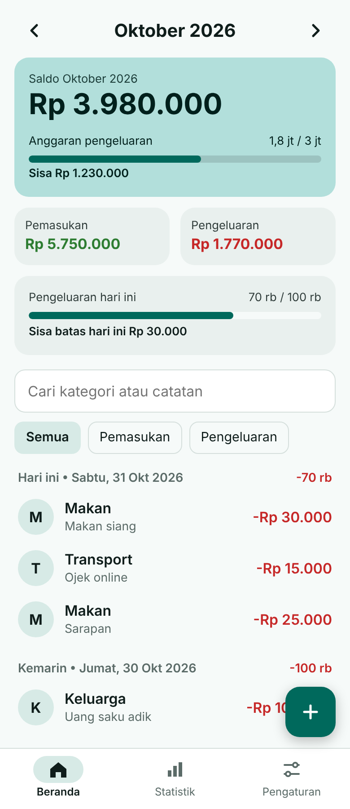
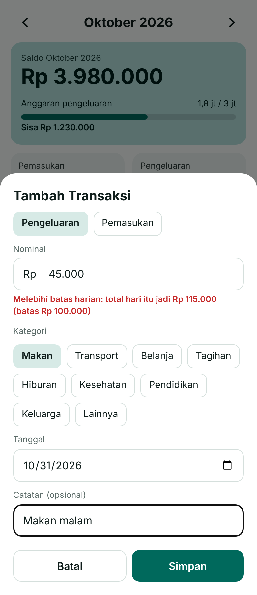
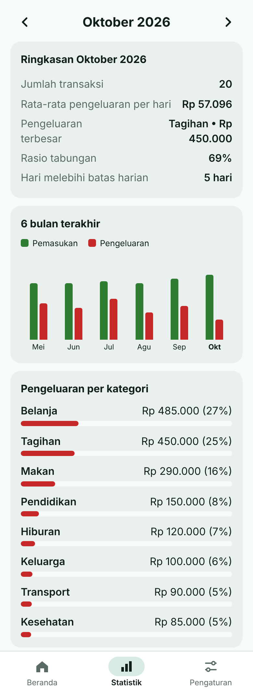
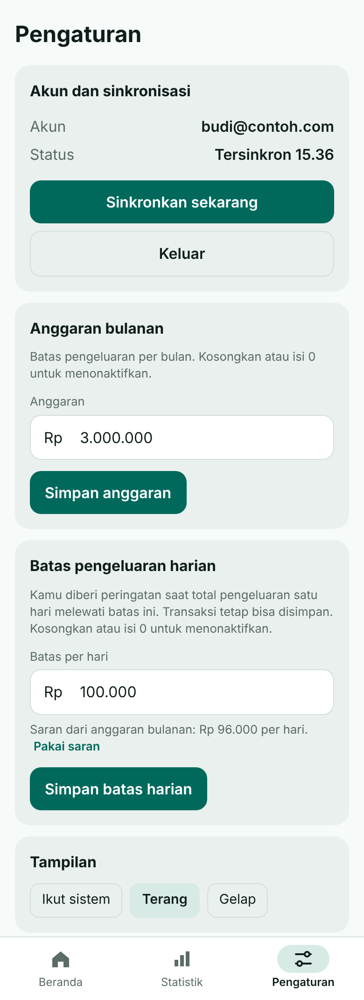
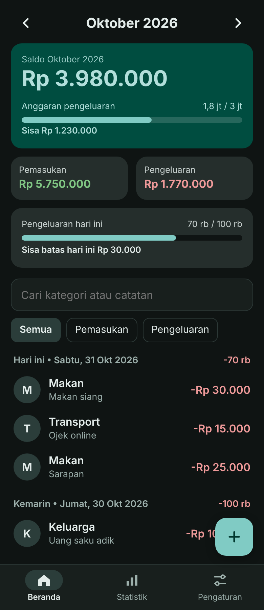

# KeuanganKu (versi web / PWA)

Aplikasi pencatat keuangan pribadi berbahasa Indonesia. Bisa dipasang di layar utama iPhone dan Android,
tetap berjalan tanpa internet, dan (opsional) menyinkronkan data ke semua perangkat lewat akun.

**Demo:** https://ekowahyudirepo.github.io/tracking-money-pwa/ (aktif jika GitHub Pages sudah dinyalakan, lihat bagian [Deploy](#deploy-ke-github-pages))

## Tampilan

<table>
  <tr>
    <td align="center"><br><sub>Masuk atau daftar</sub></td>
    <td align="center"><br><sub>Beranda: saldo, anggaran, batas harian</sub></td>
    <td align="center"><br><sub>Tambah transaksi dengan peringatan batas harian</sub></td>
  </tr>
  <tr>
    <td align="center"><br><sub>Statistik dan grafik 6 bulan</sub></td>
    <td align="center"><br><sub>Pengaturan: akun, anggaran, batas harian</sub></td>
    <td align="center"><br><sub>Mode gelap</sub></td>
  </tr>
</table>

Tangkapan layar memakai data contoh.

## Fitur

- **Transaksi:** tambah, ubah, hapus. Nominal dengan pemisah ribuan, kategori, tanggal, dan catatan.
- **Beranda:** pindah antar bulan, pencarian, filter pemasukan/pengeluaran, riwayat dikelompokkan per hari.
- **Anggaran bulanan** dengan progress bar yang berubah warna saat mendekati batas.
- **Batas pengeluaran harian:** kartu "hari ini", petunjuk sisa batas saat mengisi transaksi, peringatan saat melewati batas, dan penanda hari yang melewati batas. Ada saran batas dari anggaran bulanan.
- **Statistik:** ringkasan bulan, rasio tabungan, jumlah hari melewati batas, grafik 6 bulan, dan pengeluaran per kategori.
- **Data:** ekspor dan impor CSV (format sama dengan versi Android), bagikan ringkasan bulanan.
- **Tema:** terang, gelap, atau ikut sistem.
- **Offline:** semua fitur tetap jalan tanpa internet.
- **Akun dan sinkronisasi (opsional):** login email dan kata sandi, data tersinkron di semua perangkat.

## Cara memakai

1. Buka alamat aplikasi.
2. Pilih **Daftar** untuk membuat akun, atau **Lanjut tanpa akun** untuk memakai data lokal saja.
3. Pasang di layar utama:
   - **iPhone:** buka di Safari, ketuk Bagikan, pilih "Tambah ke Layar Utama".
   - **Android:** buka di Chrome, menu titik tiga, pilih "Instal aplikasi".

Tanpa akun, data hanya ada di browser perangkat itu. Menghapus data situs akan menghapus transaksi,
jadi lakukan **Ekspor CSV** secara berkala sebagai cadangan.

## Mengaktifkan sinkronisasi (Supabase, gratis)

Aplikasi berjalan dalam mode lokal selama `config.js` kosong. Untuk mengaktifkan akun:

1. Buat proyek di [supabase.com](https://supabase.com), lalu jalankan `supabase/schema.sql` di **SQL Editor**.
2. **Authentication > Sign In / Providers > Email:** matikan "Confirm email" (opsional, untuk pemakaian pribadi).
3. Isi `config.js` dengan **Project URL** dan kunci **anon/publishable**.
4. Commit dan push. Aplikasi akan menampilkan layar login.

**Cara kerja:** offline-first. Aplikasi selalu membaca dari data di perangkat. Setiap perubahan masuk ke antrean
dan dikirim saat online, lalu data terbaru ditarik dari server. Perubahan yang belum terkirim tidak tertimpa.

**Keamanan:**
- Tiap akun hanya bisa membaca dan menulis datanya sendiri (Row Level Security di database).
- Kunci anon/publishable memang publik dan aman ada di aplikasi web. **Jangan pernah** memasukkan kunci
  `service_role` atau `secret` ke repo ini.
- Keluar dari akun menghapus data di perangkat itu. Data tetap aman di akun.

**Proyek gratis di-pause setelah sekitar 7 hari tanpa aktivitas.** Workflow `.github/workflows/keepalive.yml`
memanggil fungsi `ping()` tiap 3 hari supaya proyek tetap aktif. GitHub menonaktifkan workflow terjadwal di repo
publik yang tidak ada aktivitasnya selama 60 hari. Jika itu terjadi, aktifkan lagi dari tab Actions.

## Struktur proyek

```
index.html              halaman utama
app.js                  logika aplikasi, antrean sinkronisasi, login
styles.css              tampilan (terang dan gelap)
config.js               konfigurasi Supabase (URL dan kunci publik)
sw.js                   service worker (offline)
manifest.webmanifest    pengaturan PWA
vendor/supabase.js      klien supabase-js (disimpan lokal agar bisa offline)
icons/                  ikon aplikasi
supabase/schema.sql     skema database dan aturan keamanan
docs/screenshots/       tangkapan layar untuk README
.github/workflows/      keepalive Supabase
```

Tanpa langkah build: hanya HTML, CSS, dan JavaScript statis.

## Pengembangan lokal

```
python3 -m http.server 8000
```

Lalu buka http://localhost:8000. Service worker aktif di localhost maupun HTTPS.

## Deploy ke GitHub Pages

1. Buka repo di GitHub: **Settings > Pages**.
2. Pada **Build and deployment**, pilih **Source: Deploy from a branch**.
3. Pilih branch `main` dan folder `/ (root)`, lalu **Save**.
4. Tunggu 1-2 menit. Alamatnya: `https://<username>.github.io/<nama-repo>/`.

Alternatif: import repo ini di Vercel atau Netlify (tanpa build command, output directory `.`).

## Versi Android

Aplikasi Android (Kotlin dan Jetpack Compose) ada di repo
[tracking-money](https://github.com/ekowahyudirepo/tracking-money). Data bisa dipindah antara Android dan web
lewat ekspor/impor CSV. Login dan sinkronisasi serta batas pengeluaran harian baru ada di versi web.
